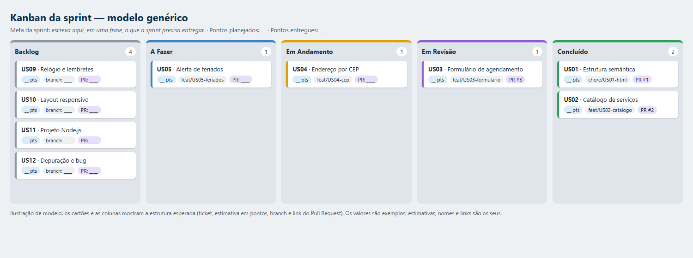

# Passo a passo: como montar o seu Kanban

Você vai montar o quadro da sprint no **Sprint Planning (16/10)** e mantê-lo atualizado até o fim do projeto. Escolha **uma** das ferramentas abaixo (Trello é a mais simples para quem nunca usou).

_Modelo genérico: 5 colunas, um cartão por história, com estimativa, branch e Pull Request. Os valores são só exemplos._

## Antes de abrir a ferramenta

1. Leia as 12 histórias (US01 a US12) no enunciado (item 4.2) e os critérios de aceite (item 5.1).
2. Tenha em mãos o arquivo `Kanban_AgendaPet_Modelo.md` (lista dos 12 cartões).
3. Defina a **meta da sprint** em uma frase. Exemplo de formato: _"A atendente consegue ___, ___ e ___, e a dona da loja consegue ___."_

## Opção A: Trello (recomendado)

1. Acesse [trello.com](https://trello.com) e crie uma conta gratuita.
2. Clique em **Criar → Criar quadro**. Nome: `AgendaPet Web - Sprint`. Em **Visibilidade**, deixe o quadro acessível a quem tem o link (veja o passo "Compartilhar" abaixo).
3. Crie **5 listas**, nesta ordem: `Backlog`, `A Fazer`, `Em Andamento`, `Em Revisão`, `Concluído`.
4. Na lista **Backlog**, crie **12 cartões**, um por ticket. Título no formato `US03 · Formulário de novo agendamento`.
5. Escreva a **meta da sprint** na descrição do quadro (menu → *Sobre este quadro*) ou em um cartão fixado no topo do Backlog.
6. Em cada cartão, adicione na descrição: critérios de aceite resumidos, **branch** e **link do Pull Request** (preencha depois).
7. Opcional: crie etiquetas de cor para a prioridade (Alta/Média) e use o título ou uma etiqueta para os **pontos**, por exemplo `5 pts`.
8. **Compartilhar:** menu do quadro → *Compartilhar* → copie o link e deixe a visibilidade como **Pública**, ou convide o e-mail do mentor. Teste abrindo o link em uma janela anônima.

## Opção B: GitHub Projects

1. No seu repositório, abra a aba **Projects → New project** e escolha o template **Board**.
2. Renomeie o projeto para `AgendaPet Web - Sprint`.
3. Edite o campo **Status** para ter as colunas: `Backlog`, `A Fazer`, `Em Andamento`, `Em Revisão`, `Concluído`.
4. Adicione os 12 itens (**+ Add item**), um por ticket. Se preferir, crie 12 **Issues** e adicione ao projeto.
5. Crie um campo numérico **Pontos** (**+** na barra de campos → *Number*) e preencha a estimativa.
6. Em **Settings → Manage access**, deixe o projeto visível para quem tem o link (ou público). Copie a URL.
7. Vantagem: ao abrir um Pull Request, você pode vincular ao item e o cartão se move com mais facilidade.

## Opção C: Notion

1. Crie uma página e insira um **banco de dados** (*Table*), importando o arquivo `Kanban_AgendaPet_Modelo.csv` (**Importar → CSV**).
2. Converta a propriedade `Coluna` em **Status** (ou *Select*) com as 5 opções.
3. Adicione uma visualização **Board** agrupada por `Coluna`.
4. Compartilhe a página: **Share → Publish** (ou convide o mentor) e copie o link.

## Opção D: sem ferramenta externa

É permitido usar uma **planilha** (abra o `.csv`) ou um **quadro em Markdown no README**, desde que tenha as colunas e o histórico de movimentação, e uma imagem do quadro em `docs/kanban.png`. Nesse caso, o link do quadro é o link do README ou da planilha compartilhada.

## Sprint Planning (dia 16/10): preencha o quadro

1. **Estime** cada cartão em pontos: **1, 2, 3, 5 ou 8**. Use a complexidade, não as horas (a história mais difícil recebe a maior nota; compare as demais com ela).
2. Defina a **ordem de execução** e o porquê (o que depende de quê).
3. Mova para **A Fazer** os cartões que cumprem a Definição de Pronto para Iniciar:
   - [ ] história lida e critérios de aceite entendidos;
   - [ ] ticket estimado em pontos;
   - [ ] branch criada com o nome padronizado (ex.: `feat/US03-formulario`).
4. Registre tudo em `planejamento/sprint-planning.md`: meta da sprint, ordem e por quê, estimativa de cada ticket, riscos (ex.: API fora do ar) e o que seria cortado se faltasse tempo.
5. Tire um print do quadro e guarde em `docs/kanban.png` (refaça no fim da sprint).

## Durante a sprint: como movimentar os cartões

| Quando acontece | Mova o cartão para |
|---|---|
| Cartão estimado e pronto para iniciar | **A Fazer** |
| Você criou a branch e começou a codar | **Em Andamento** (um por vez) |
| Você abriu o Pull Request | **Em Revisão** (cole o link do PR no cartão) |
| PR integrado na `main` e Definição de Pronto cumprida | **Concluído** |

Regras de ouro:
- **Cada cartão cita o nome da branch e o link do Pull Request.**
- **Movimente ao longo das duas semanas.** Deixar tudo em Concluído no último dia prejudica a nota: o histórico de movimentação é avaliado.
- Se um cartão voltar (por exemplo, o PR precisou de ajustes), mova de volta para **Em Andamento**.

## O que entregar

- O **link do quadro**, acessível a quem corrige, enviado no AVA junto ao link do repositório do GitHub.
- O print em `docs/kanban.png` e o arquivo `planejamento/sprint-planning.md` no repositório.
- Na apresentação em live coding (30/10), esteja com o quadro aberto: você vai mostrar o Kanban, a meta da sprint e as estimativas.

## Checklist rápido

- [ ] Quadro com as 4 colunas obrigatórias (Backlog, A Fazer, Em Andamento, Concluído); recomendada a 5ª, Em Revisão
- [ ] 12 cartões (US01 a US12), todos estimados em pontos
- [ ] Meta da sprint escrita
- [ ] Branch e link do Pull Request em cada cartão
- [ ] Cartões movimentados durante a sprint
- [ ] Link acessível a quem corrige (teste em janela anônima)
- [ ] `docs/kanban.png` e `planejamento/sprint-planning.md` no repositório
